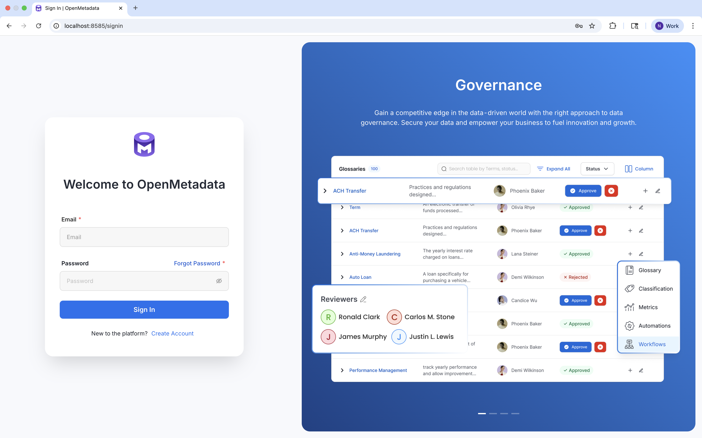
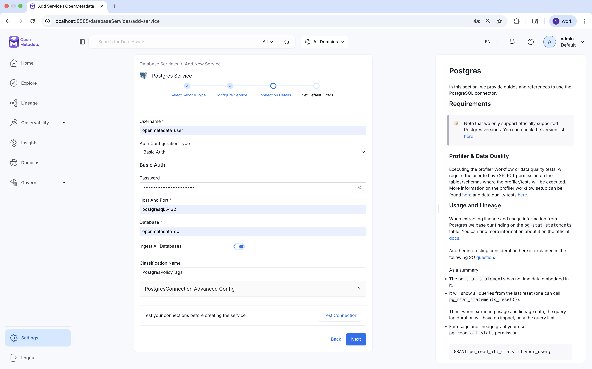
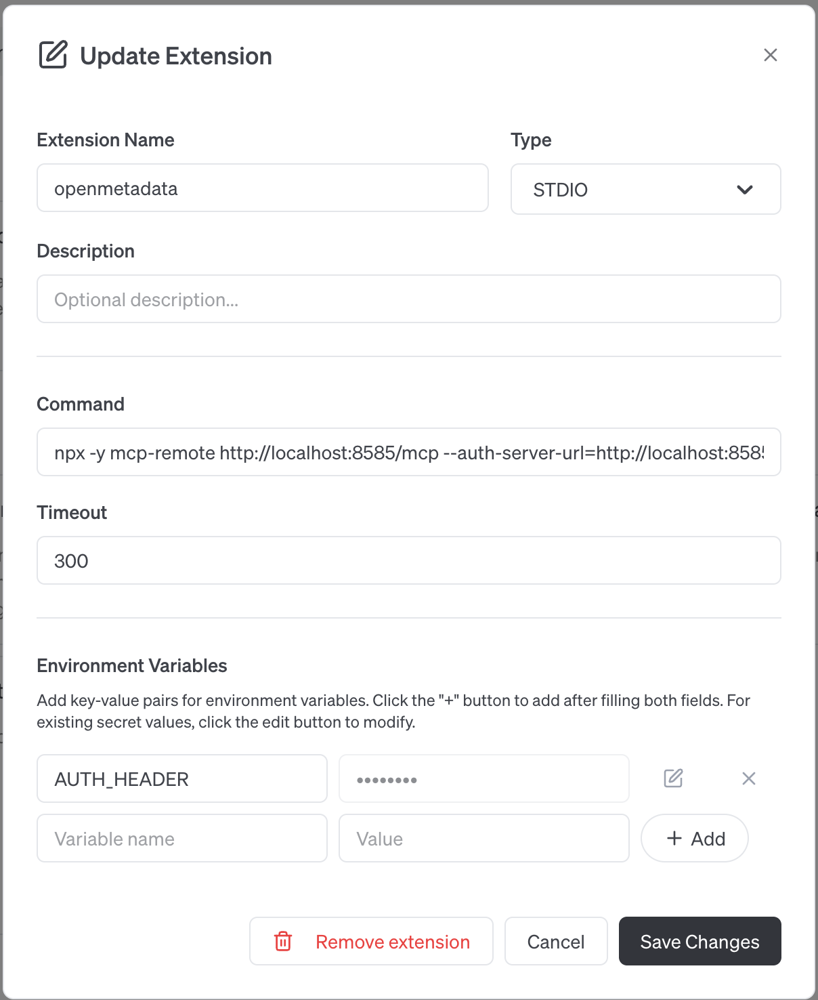
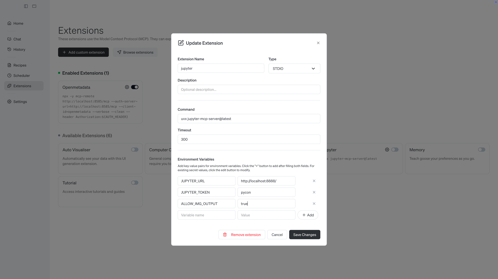
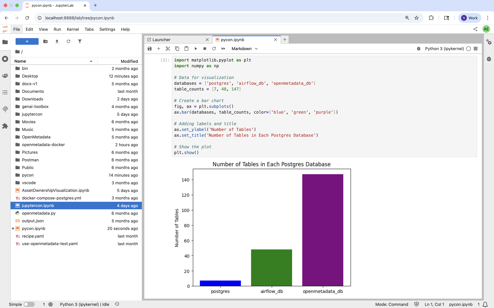

# OpenMetadata MCP Workshop

This workshop connects the OpenMetadata Model Context Protocol (MCP) server to Goose and then
combines it with a Jupyter MCP server for metadata exploration and visualization.

> [!IMPORTANT]
> This local setup targets the OpenMetadata `2.0.0-rc1` prerelease. The workshop is validated for
> links and checked-in seed-file invariants only. It is not exercised end to end in CI, and UI labels may
> change before the final 2.0 release.

## Prerequisites

Install the following tools:

1. [Node.js](https://nodejs.org/en/download)
2. [Docker Desktop](https://www.docker.com/products/docker-desktop/)
3. [Goose Desktop](https://goose-docs.ai/docs/quickstart/)
4. Python 3.10 or later
5. [uv](https://docs.astral.sh/uv/getting-started/installation/)

Configure Goose with an AI provider before starting the workshop.

## Install OpenMetadata

From the repository root, download the official OpenMetadata 2.0 RC Compose file and start its
services:

```bash
curl -fsSL -o docker-compose-postgres.yml \
  https://github.com/open-metadata/OpenMetadata/releases/download/2.0.0-rc1-release/docker-compose-postgres.yml
docker compose -f docker-compose-postgres.yml up --detach
```

Wait for OpenMetadata to become available at
[http://localhost:8585](http://localhost:8585). Then load the local
[PostgreSQL seed data](resources/postgres-script.sql):

```bash
docker exec -i openmetadata_postgresql \
  psql -v ON_ERROR_STOP=1 -U postgres -d postgres \
  < mcp/resources/postgres-script.sql
```

The checked-in seed file is the version used by this workshop. `ON_ERROR_STOP` makes the command
fail immediately if the database rejects a statement. The seed grants database access to
`openmetadata_user`, installs `pg_stat_statements`, grants `pg_read_all_stats`, and drops and
recreates the workshop's `actor`, `bad_actor`, `film_actor`, `sensitive_customers`, `actor_view`,
`actor_actor_id_seq`, and `sensitive_customers_id_seq` objects in the `postgres` database. Run it
only against the disposable database started by this workshop's Compose stack.

|  |
| :--: |
| OpenMetadata login page |

## Add PostgreSQL to OpenMetadata

The seed data is stored in the PostgreSQL container that also stores OpenMetadata state. Add that
container as a database service for the workshop:

1. Open [Database Services](http://localhost:8585/settings/services/databases).
2. Log in with the default local email `admin@open-metadata.org` and password `admin`.
3. Select **Add New Service**, choose **Postgres**, and select **Next**.
4. Enter `postgres` as the service name.
5. Configure the connection:
   - Username: `openmetadata_user`
   - Authentication type: **Basic Auth**
   - Password: use the `DB_USER_PASSWORD` value from `docker-compose-postgres.yml`. Its local
     development default is `openmetadata_password`.
   - Host and port: `postgresql:5432`
   - Database: `openmetadata_db`
   - Ingest all databases: enabled
6. Save the service without adding database filters.

|  |
| :--: |
| PostgreSQL connector settings |

Run the metadata ingestion from the new service page. After it completes, the seeded assets appear
under the `postgres.postgres.public` schema.

## Connect OpenMetadata to Goose

The local workshop uses a Personal Access Token (PAT). OAuth is recommended for shared or
production deployments. Follow the [OpenMetadata MCP authentication guide](https://docs.open-metadata.org/latest/how-to-guides/mcp)
when adapting this setup beyond a local workshop.

1. Open the local [admin access-token page](http://localhost:8585/users/admin/access-token).
2. Generate a token and copy it.
3. In Goose, open **Extensions** and select **Add custom extension**.
4. Enter the following values:
   - Extension name: `openmetadata`
   - Type: `STDIO`
   - Command:

     ```text
     npx -y mcp-remote http://localhost:8585/mcp --auth-server-url=http://localhost:8585/mcp --client-id=openmetadata --verbose --clean --header Authorization:${AUTH_HEADER}
     ```

   - Timeout: `300`
   - Environment variable name: `AUTH_HEADER`
   - Environment variable value: `Bearer <PASTE_OPENMETADATA_TOKEN_HERE>`
5. Save the extension.

The command follows the current
[Goose OpenMetadata extension guide](https://goose-docs.ai/docs/mcp/openmetadata-mcp/).

|  |
| :--: |
| OpenMetadata MCP extension settings |

## Explore Metadata With Goose

Open the [`postgres.postgres.public` schema](http://localhost:8585/databaseSchema/postgres.postgres.public)
and apply the **Gold** certification to the schema. Start a new Goose session and provide the fully
qualified name (FQN). Ask Goose to inspect the schema, count its tables, and apply the same
certification to its tables. Confirm the changes in OpenMetadata after Goose finishes.

This step intentionally avoids fixed asset counts. The response should reflect the assets present in
the running RC environment.

## Add Jupyter MCP

Create a virtual environment and install the versions recommended by the current
[Jupyter MCP Server setup](https://github.com/datalayer/jupyter-mcp-server#getting-started):

```bash
python3 -m venv pycon
source pycon/bin/activate
pip install \
  jupyterlab==4.4.1 \
  jupyter-collaboration==4.0.2 \
  'jupyter-mcp-tools>=0.1.4' \
  ipykernel \
  pycrdt
JUPYTER_TOKEN="$(python -c 'import secrets; print(secrets.token_urlsafe(32))')"
export JUPYTER_TOKEN
printf 'Jupyter token: %s\n' "$JUPYTER_TOKEN"
jupyter lab --port 8888 --IdentityProvider.token "$JUPYTER_TOKEN" --ip 127.0.0.1
```

JupyterLab is available at [http://localhost:8888](http://localhost:8888). Use the token printed in
the terminal when prompted.

In Goose, add another custom extension:

- Extension name: `jupyter`
- Type: `STDIO`
- Command: `uvx jupyter-mcp-server@latest`
- Timeout: `300`
- Environment variables:
  - `JUPYTER_URL`: `http://localhost:8888`
  - `JUPYTER_TOKEN`: the token printed when JupyterLab started
  - `ALLOW_IMG_OUTPUT`: `true`

Save the extension after adding each environment variable.

|  |
| :--: |
| Jupyter MCP extension settings |

## Combine the MCP Servers

Ask Goose to query the actual table counts and build a notebook from those results. For example:

```text
Report the table count for each database available through the postgres OpenMetadata service.
```

Then ask it to create a visualization:

```text
Create pycon.ipynb and visualize the reported table counts by database.
```

Verify the values in OpenMetadata before relying on the generated notebook. The steps ask you to
validate the local setup manually; CI checks only links and seed-file invariants, not
model-generated analysis.

|  |
| :--: |
| OpenMetadata and Jupyter MCP servers used together |

## Optional: Connect to the OpenMetadata Sandbox

The [OpenMetadata Sandbox](https://sandbox.open-metadata.org/) is a hosted environment maintained by
Collate. Generate a PAT from the sandbox and repeat the OpenMetadata extension setup with these
changes:

- Extension name: `collate`
- Command:

  ```text
  npx -y mcp-remote https://sandbox.open-metadata.org/mcp --auth-server-url=https://sandbox.open-metadata.org/mcp --client-id=openmetadata --verbose --clean --header Authorization:${COLLATE_AUTH_HEADER}
  ```

- Environment variable name: `COLLATE_AUTH_HEADER`
- Environment variable value: `Bearer <PASTE_SANDBOX_TOKEN_HERE>`

Keep the local and hosted extension names distinct so Goose can target the intended server.

## Shut Down the Workshop

1. Return to the terminal running JupyterLab, press <kbd>Ctrl</kbd>+<kbd>C</kbd>, and confirm the
   shutdown if prompted.
2. Deactivate the Python virtual environment:

   ```bash
   deactivate
   ```

3. Stop the local services from the repository root:

   ```bash
   docker compose -f docker-compose-postgres.yml down
   ```
